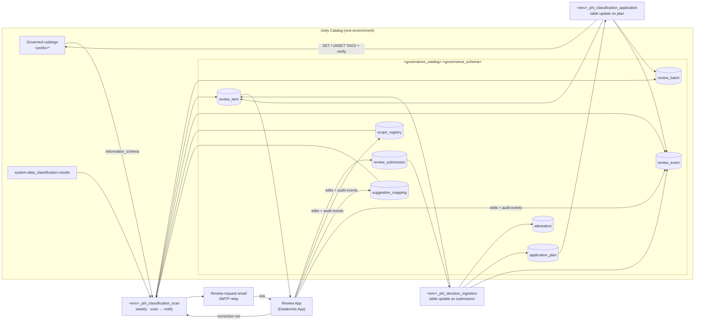

# PHI Classification Framework for Unity Catalog

A reference implementation of a repeatable, auditable process for classifying
Protected Health Information (PHI) at the column level in Unity Catalog. It
finds in-scope columns that lack a direct PHI governed tag, emails each scope's
reviewers, collects their decisions in a Databricks App, applies the approved
tags automatically, and keeps evidence for every decision.

Two outcomes are valid for every column:

1. **It contains PHI** and receives an approved value of the governed tag
   (default key `phi_classification`).
2. **It is confirmed not to contain PHI** and receives a documented,
   time-bound non-PHI attestation.

> A missing tag never means "not PHI". It means "not yet classified or attested".

Stewards review in the **review App**. There are no workbooks, file handoffs,
or manual steward assignment: each scope in the registry names its reviewers,
the App records the signed-in reviewer and the time of each decision, and the
jobs validate every submission before anything is tagged.

This is a reference implementation built and tested against synthetic data.
Review it, adapt it, and validate it in your own environment before relying on
it for compliance evidence.

---

## Contents

- [Architecture](#architecture)
- [The review App](#the-review-app)
- [Prerequisites](#prerequisites)
- [Configuration](#configuration)
- [Deploy](#deploy)
- [Operate: the weekly cycle](#operate-the-weekly-cycle)
- [Governance records](#governance-records)
- [Security and access](#security-and-access)
- [Testing](#testing)
- [Repository layout](#repository-layout)
- [Further reading](#further-reading)

---

## Architecture

Each environment (dev, qa, prod) runs its own deployment that processes only
that environment's catalogs.



### The operating flow

| # | Step | Who | What happens |
|---|---|---|---|
| 1 | Define scope | Data Governance, in the App | Maintain `classification_scope_registry` (catalog/schema, risk tier, `steward_group`, `governance_owner`) and `classification_suggestion_mapping`. Every edit records a before/after audit event. |
| 2 | Weekly scan | `scan` job (Monday 06:00) | Reads metadata, tags, attestations, and Data Classification results. Opens or refreshes one review item per actionable column. Each item's reviewers are the scope's `steward_group`. |
| 3 | Notify reviewers | `scan` job, `notify_reviewers` task | One email per new batch: to everyone the scope's `steward_group` names, copying the `governance_owner`, with a link to the batch in the App. |
| 4 | Review | Stewards (or the governance owner), in the App | Each reviewer sees only the scopes they review, chooses a decision per column (or bulk-approves suggestions), and submits. The App records the signed-in identity and the submit time. |
| 5 | Ingest and validate | `ingestion` job (table-update trigger on `classification_review_submission`) | Re-validates every submission and writes immutable plans, non-PHI attestations, Privacy routing, or `VALIDATION_FAILED`. Rejected items return to the reviewer's queue with the reason. |
| 6 | Apply tags | `application` job (table-update trigger on `classification_application_plan`) | Rechecks each column, executes the stored DDL, verifies the tag in `information_schema.column_tags`. |
| 7 | Record results | all jobs | Item statuses, batch closure, and an append-only event trail. |
| 8 | Repeat | `scan` job | Unchanged valid decisions are skipped; changed, stale, and recertification-due columns reopen. |

### What the scan detects

One issue type per column per scan, using the first match in this order:

| Issue type | Meaning |
|---|---|
| `CORRECTION_REQUESTED` | Data Governance reopened a resolved column (requested in the App; on-demand scan run). |
| `INVALID_TAG_VALUE` | The tag value is not in the governed tag's allowed values. |
| `STALE_PHI_REVIEW` | A verified PHI column's name, type, or comment changed. |
| `STALE_NON_PHI_ATTESTATION` | An attested column's name, type, or comment changed. |
| `ORPHANED_TAG` | A tag without framework review evidence (off by default). |
| `RECERTIFICATION_DUE` | Three months (HIGH) or six months (STANDARD) since verification or attestation. |
| `MISSING_CLASSIFICATION` | No tag and no non-PHI attestation. |

Suggestions come from Data Classification: high-confidence detections only,
the latest detection only, and only when every detection maps to the same
allowed value. Sample values are never read into the framework.

### Who reviews

Reviewers come from the scope registry, not from an assignment step:

- **`steward_group`** holds one user email or one group name. Every user it
  names receives the review email and can decide that scope's items.
- **`governance_owner`** holds one user email or one group name. It is copied on
  the review email and may review in place of a steward.
- A value matches a workspace group with that exact name first; otherwise a
  value containing `@` is a single user.
- Each `DECISION_RECEIVED` event records `acting_as`: `STEWARD`,
  `GOVERNANCE_OWNER`, or (for Privacy outcomes) `DATA_GOVERNANCE`.
- Privacy outcomes can be recorded by a member of `governance_group` or by the
  scope's `governance_owner`.
- Each scan refreshes `assigned_steward` on open items from the registry, so a
  changed `steward_group` reroutes work already in flight.

---

## The review App

`app/` is an [AppKit](https://github.com/databricks/appkit) (TypeScript/React)
Databricks App, deployed by the bundle as `resources/review_app.yml`. It reads
and writes through a SQL warehouse; there is no separate database.

| Tab | Who | What |
|---|---|---|
| My reviews | Stewards and governance owners | Columns awaiting a decision in the user's scopes, with metadata, issue, suggestion and reason, due date, and any rejection reason from the last validation. Decision and comment per row; bulk "approve suggestions" for selected rows. |
| Privacy review | Data Governance and governance owners | Items in `NEEDS_PRIVACY_REVIEW`, with the steward's question. Records the final outcome. |
| Scope registry | Everyone can view; Data Governance edits | Add or edit scopes. The catalog must start with the environment's prefix. Request a correction for a resolved column. |
| Suggestion mapping | Everyone can view; Data Governance edits | Add or edit mappings; values must be in the governed tag policy. Deactivate rather than delete. |

How it is built:

- **Identity.** The Databricks Apps proxy authenticates every request and sets
  `X-Forwarded-Email`. The App also uses the user token the proxy forwards
  with the default `iam.current-user:read` scope and reads the signed-in user's own groups from SCIM `/Me` with
  their forwarded token. Role checks compare those groups and the user's email
  with each scope's `steward_group` and `governance_owner`. The App's service
  principal never reads group member lists.
- **Server routes.** All reads and writes go through `app/server/routes.ts`
  (`/api/review/*`). Queues are filtered on the server to the scopes the user
  may act on. Every statement is parameterized and runs as the App's service
  principal.
- **Writes.** A submit writes one submission set per batch to
  `classification_review_submission`, with the authenticated reviewer, the
  server time, the suggestion the reviewer saw, and the role the reviewer acted
  in with the scope value that authorized it (`acting_as`, `authorized_via`).
  The App checks every decision for immediate feedback. Ingestion re-checks the
  decision rules and trusts the App's reviewer check: it confirms the recorded
  value is still the scope's current steward group, governance owner, or Data
  Governance group, and never reads group member lists. Scope and mapping edits are MERGEs plus a
  `SCOPE_REGISTRY_UPDATED` / `SUGGESTION_MAPPING_UPDATED` event with the
  before and after values. A correction request starts the scan job with the
  correction parameters and records `CORRECTION_REQUESTED`.
- **Grants (declared in the bundle, granted on deploy).** `CAN_USE` on the SQL
  warehouse; `CAN_MANAGE_RUN` on the scan job; `EXECUTE` on `make_key`;
  `SELECT` on the batch, item, scope, mapping, event, and submission tables;
  `MODIFY` only on the submission, scope registry, suggestion mapping, and
  event tables.
- **Access to the App.** `CAN_USE` for `governance_group` and
  `review_app_users_group` (include every steward and governance owner);
  `CAN_MANAGE` for `platform_group`.

### Local App development

```bash
cd app
cp .env.example .env      # fill in host, warehouse, governance schema, scan job id
npm install
npm run dev               # http://localhost:8000
```

Locally there are no proxy headers, so `PHI_DEV_USER_EMAIL` and
`PHI_DEV_USER_GROUPS` (comma-separated) stand in for the signed-in user. Both
are honored only when `NODE_ENV=development`.

---

## Prerequisites

| Requirement | Notes |
|---|---|
| Databricks CLI ≥ 0.288 | `databricks -v` |
| [uv](https://docs.astral.sh/uv/) | Builds the wheel and runs the operator tools. |
| Python 3.12 | For local tests and tools (uv installs it if needed). |
| Node.js 20+ and npm | Only for local App development and App unit tests. Databricks Apps installs and builds the App on deploy. |
| Unity Catalog workspace per environment | Serverless jobs and Databricks Apps enabled. |
| Governed tag | An account-level tag policy (default key `phi_classification`) with the allowed values. Its values are the single source of truth for validation. |
| Data Classification | Enabled on each governed catalog, with `SELECT` on `system.data_classification.results` granted to the framework identity only. |
| SQL warehouse | Used by the App, by `scripts/deploy.sh` to bootstrap the schema, and by the operator tools. |
| Groups | One Data Governance group, one Data Platform group, one App users group, and (optionally) one steward group per scope. |
| SMTP relay | For review-request emails. Optional: without it, reviewers still see their queues in the App. |
| Service principal | qa and prod jobs run as a dedicated service principal. |

> **Group membership reads (email only, open decision).** Workspace SCIM
> restricts reading a group's member list to workspace admins (the App's
> service principal received `403 ... is only accessible by admins`). Reviewer
> authorization never needs it: the App checks the signed-in user's own groups,
> and ingestion and correction scans trust that check. Only the notify task's
> email expansion reads member lists: to email every member of a group-valued
> `steward_group` or `governance_owner`, the framework service principal in qa
> and prod needs to read those member lists. How to grant it is not decided or
> verified. Until it is, single-email reviewer values are emailed and group
> values are not; reviewers can still work their queues in the App.

---

## Configuration

All configuration is bundle variables (`databricks.yml`), overridable per target
or with `BUNDLE_VAR_<name>` environment variables.

| Variable | Default | Purpose |
|---|---|---|
| `env` | per target | `dev`, `qa`, or `prod`. Logical job names are `<env>_phi_classification_scan`, `<env>_phi_decision_ingestion`, `<env>_phi_classification_application`; the App writes as `<env>_phi_review_app`. |
| `governance_catalog` | per target | Catalog that holds the governance schema. |
| `governance_schema` | `data_governance` | Governance schema. |
| `governed_catalog_prefix` | per target | Every governed catalog in the environment starts with this prefix. Enforced by a CHECK constraint, every job, and the App. |
| `tag_key` | `phi_classification` | Governed tag applied to PHI columns. |
| `governance_group` | per target | Edits the scope registry and mapping in the App, records Privacy outcomes, requests corrections. Gets `CAN_MANAGE_RUN` on the scan and ingestion jobs and `CAN_USE` on the App. |
| `platform_group` | per target | Gets `CAN_MANAGE` on all jobs and the App. |
| `framework_service_principal` | `""` | Application ID the qa and prod jobs run as (required there). |
| `review_app_name` | required | Name of the review App (lowercase letters, digits, and hyphens). Emails link to it. |
| `warehouse_id` | required | SQL warehouse the App uses. |
| `review_app_users_group` | required | Group granted `CAN_USE` on the App; include every steward and governance owner. |
| `smtp_host` | `""` | SMTP relay for review-request emails. Empty disables email. |
| `smtp_port` | `587` | SMTP port. |
| `smtp_sender` | `""` | From address. Required when `smtp_host` is set. |
| `smtp_secret_scope` | `""` | Secret scope holding optional `smtp_username` and `smtp_password` keys. Empty for an unauthenticated relay. |
| `smtp_use_tls` | `true` | Use STARTTLS. |
| `data_classification_table` | `system.data_classification.results` | Set to `""` to disable suggestions. |
| `review_due_business_days` | `10` | Reviewer SLA used for `due_at`. |
| `business_timezone` | `UTC` | Scan schedule and the 17:00 due time. |
| `detect_orphaned_tags` | `false` | Enable `ORPHANED_TAG` findings. |
| `allowed_values_override` | `""` | **dev only**: comma-separated allowed values for sandboxes without a governed tag policy. Rejected in qa and prod (by the jobs and the App). |
| `excluded_table_regex` | pipeline-internal tables | Tables matching this regex are never scanned. |
| `failure_notification_emails` | `[]` | Notified when any job fails. |

`workbook_protection_password` was removed with the workbooks.

Edit the qa/prod target blocks in `databricks.yml` with your catalog names and
groups, or supply them from CI as `BUNDLE_VAR_*` variables.

---

## Deploy

```bash
# 1. Validate, bootstrap the governance objects, deploy jobs and the App, start the App
scripts/deploy.sh dev  <warehouse_id> <cli_profile>
scripts/deploy.sh qa   <warehouse_id>            # CI: DATABRICKS_HOST + OAuth M2M
scripts/deploy.sh prod <warehouse_id>            # prod deploys only from CI

# 2. Load the initial reference data (later edits happen in the App)
uv run python tools/load_reference_data.py -p <profile> --warehouse-id <id> \
    --catalog <governance_catalog> --schema data_governance \
    --scopes reference_data/scope_registry.csv \
    --mapping reference_data/suggestion_mapping.csv

# 3. Run the first scan (dev: jobs run only when started manually)
databricks bundle run phi_classification_scan -t dev -p <profile>
```

`scripts/deploy.sh` runs four steps:

1. `databricks bundle validate --strict`.
2. `tools/bootstrap.py`, which runs the same setup code as the
   `<env>_phi_framework_setup` job through a SQL warehouse. The governance
   tables must exist before deploy: Lakeflow Jobs validates the table-update
   triggers (on the submission and plan tables) when a job is created, and the
   App's Unity Catalog resources reference the tables and `make_key`.
3. `databricks bundle deploy`.
4. `databricks bundle run phi_review_app`, which deploys the App source and
   starts it. Databricks Apps installs and builds the App from
   `app/package.json`.

All steps are idempotent. Rerun the setup job after upgrades to apply new
columns, comments, or constraint changes.

**Upgrading a deployment created by the workbook version.** Use a fresh
governance schema. Setup adds columns but never drops them, so the old
submission table keeps `NOT NULL` columns the App does not write, and existing
`WORKBOOK_*` events fail the new event-type CHECK constraint.

**Promotion.** Validate in dev, deploy to qa from CI, then promote the same
commit to prod. qa and prod run as `framework_service_principal`; the bundle
refuses to validate without it.

**Development mode** prefixes job names with `[dev <user>]` and pauses the
schedule and both triggers. The jobs still write the logical `process_name`
(for example `dev_phi_classification_scan`), so the audit CHECK constraints
hold. In dev, run ingestion and application manually after submitting in the App.

---

## Operate: the weekly cycle

**Monday: scan and notify.** The scan opens items, then the `notify_reviewers`
task emails each new batch's reviewers with a link to the batch in the App. A
send records `REVIEW_REQUEST_SENT`. Each batch is handled on its own: a reviewer
value that cannot be resolved (for example a group whose members the job cannot
read) is listed on the event and the email still goes to everyone else. A batch
with no resolvable recipients records `REVIEW_REQUEST_FAILED` (kind
`RECIPIENTS`) once and is not retried. A send failure records
`REVIEW_REQUEST_FAILED` (kind `SEND`), is retried by the next scan, and fails the
task (so `failure_notification_emails` fire) after every batch is attempted. The email has counts, scope, due date, and the link; never column data.

**Reviewer: decide in the App.** For each column choose
`APPROVE_SUGGESTION`, `CORRECT_CLASSIFICATION` (pick an allowed value),
`CONFIRM_NOT_PHI` (comment required), or `REQUEST_PRIVACY_REVIEW` (comment
required), then submit. Selected rows can be bulk-approved. The App rejects
invalid decisions before writing anything.

**Automatic: ingest and apply.** Ingestion runs on new submissions (about a
minute after the last write), turns valid decisions into plans and attestations,
and returns rejected ones to the reviewer's queue with the reason. Tags are
applied and verified within minutes.

**Privacy review.** Items in `NEEDS_PRIVACY_REVIEW` appear on the Privacy
review tab. Once Privacy decides, a member of `governance_group` or the
scope's `governance_owner` records the outcome there. A rejected outcome keeps
the item in Privacy review.

**Corrections.** On the Scope registry tab, Data Governance requests a
correction for `<catalog>.<schema>.<table>.<column>` with a reason. The App
starts the scan with the correction parameters, which opens a
`CORRECTION_REQUESTED` item in a new batch, pre-filled with the current tag. If
the column already has an open item, nothing is opened and that item's
decision serves as the correction.

**Scope and mapping changes.** Made in the App by Data Governance and recorded
as `SCOPE_REGISTRY_UPDATED` / `SUGGESTION_MAPPING_UPDATED` events with before
and after values. Pause a scope with `scan_enabled` or an expiration date, and
deactivate a mapping with `is_active`; neither is deleted.

**Application failures.** Failed items keep `application_error`, and the job
run fails so `failure_notification_emails` are alerted. After remediation, run
the application job with `retry_failed=true`. If the column changed after
approval, the next scan closes the failed item and reopens the column for review.

**Monthly review.** Example queries are in `docs/queries.sql`: classification
completeness, aging and overdue items, failures by reason, and changes ignored
for already-accepted items.

---

## Governance records

All in `<governance_catalog>.<governance_schema>`:

| Table | Rows change | Written by |
|---|---|---|
| `classification_scope_registry` | Created and updated | Data Governance through the App (`<env>_phi_review_app`), or `MANUAL` for bootstrap |
| `classification_suggestion_mapping` | Created and updated | Data Governance through the App, or `MANUAL` for bootstrap |
| `classification_review_batch` | Created and updated | Jobs |
| `classification_review_item` | Created and updated | Jobs |
| `classification_attestation` | Created; superseded | Jobs |
| `classification_application_plan` | Append-only | Ingestion |
| `classification_review_event` | Append-only | Jobs and the App (reference-data edits, corrections) |
| `classification_review_submission` | Append-only | The App |

Integrity controls (all created by `src/phi_framework/setup.py`):

- **Deterministic keys** (`make_key`): reruns and retries never duplicate rows.
- **CHECK constraints** on every controlled value, the environment/catalog
  guardrail, non-empty trimmed reviewer values, a lower-case `reviewed_by`, and
  audit process names. `MANUAL` is allowed only on the two reference tables;
  the App process only on the submission, reference, and event tables.
- **`delta.appendOnly`** on plans, events, and submissions.
- **Informational PK/FK constraints**, **NOT NULL**, and column comments.
- **Deletion vectors and row tracking** for row-level concurrency.
  `max_concurrent_runs: 1` per job, and task retries (none on the email task,
  so a retry never resends).
- **Audit columns** on every row (`audit_created_*`, `audit_updated_*`). App
  writes use an App request id as the run id.

---

## Security and access

Minimum grants (verify in your environment; names are illustrative):

| Principal | Grants |
|---|---|
| Framework service principal | `USE CATALOG`, `USE SCHEMA`, and `SELECT` (or `BROWSE`) on governed catalogs so their objects appear in `information_schema`; `APPLY TAG` on governed catalogs; `ASSIGN` on the governed tag policy; `SELECT` on `system.data_classification.results`; `ALL PRIVILEGES` on the governance schema; `READ` on the SMTP secret scope; the ability to read reviewer group membership (see the prerequisite note). |
| Review App service principal | Declared in `resources/review_app.yml` and granted on deploy (see [The review App](#the-review-app)). Reads the governed tag policy for allowed values. |
| Data Governance group | `CAN_USE` on the App; `CAN_MANAGE_RUN` on the scan and ingestion jobs; `SELECT` on governance tables for reporting. Edits reference data through the App, not directly. |
| Stewards and governance owners | `CAN_USE` on the App (through `review_app_users_group`). No direct table access. |

Notes:

- Data Classification `samples` are never selected, so sample values never reach
  governance tables, the App, or email.
- The App and the email show column metadata (names, types, comments), not table
  data. Column comments are free text, so keep them free of PHI.
- Reviewer identity and decision time come from the authenticated App session and
  the App server, not from user input.
- Ingestion re-validates every decision rule: a decision written directly to the
  submission table, bypassing the App's checks, is still rejected if it breaks a
  rule or its recorded authorization no longer matches the scope's reviewers (the
  end-to-end test proves this).
- Trust boundary: reviewer authorization is the App's check against the user's
  own groups. Only the App's service principal (and table owners and admins) can
  write `classification_review_submission`, and the writer CHECK constraint limits
  the audit process to the jobs and the App. Keep MODIFY on that table limited to
  the App.

---

## Testing

```bash
# Python unit tests (no workspace needed): 64 tests
uv run --with pytest pytest

# Lint
uv run ruff check src tests tools

# App unit tests, lint, and type checks
cd app && npx vitest run && npm run lint && npm run typecheck && cd ..

# End-to-end against a deployed dev sandbox with synthetic data (81 checks)
uv run python tests/integration/e2e_sandbox.py \
    -p <profile> --warehouse-id <id> \
    --steward-group <dev test steward group> \
    --mapping <mapping CSV whose values match the tag policy>
```

Before running the end-to-end test:

- **Deploy first** (`scripts/deploy.sh dev ...`). The test drives the deployed
  App over HTTPS as the signed-in CLI user, so the App must be running.
- **Use a throwaway governance schema.** Set the bundle's `governance_schema` to a test
  schema starting with `phifw_`. `--reset` drops and recreates the governance schema and the
  synthetic schemas, and it refuses to run unless every one of them starts with `phifw_`.
  A real `data_governance` schema can never be dropped by the test.
- **Join the test groups.** Create a dev-only steward group and pass it as `--steward-group`.
  The user running the test must belong to that group, to the bundle's `governance_group`,
  and to `review_app_users_group`.

`--mapping` must point to a mapping whose values exist in your tag policy.
`tests/integration/fixtures/suggestion_mapping_hipaa18.csv` targets an 18-identifier
HIPAA value list (`name`, `address`, `date`, `phone_number`, `ssn`, `mrn`, `account_number`, ...).
With a governed tag, the test exercises `ORPHANED_TAG` instead of `INVALID_TAG_VALUE`,
because Unity Catalog rejects values outside the policy.

The end-to-end test seeds synthetic tables, a materialized view, and synthetic
Data Classification results. One scope uses a group as its steward group; the
other uses single emails, with the test user as governance owner only, so its
decisions exercise review in place of a steward. The test then:

- checks the App's identity and role resolution and the reviewer queue;
- submits every decision type through the App, and confirms the App refuses
  invalid ones without writing;
- injects invalid submissions directly into the submission table, and confirms
  ingestion still rejects them (value outside the policy, unauthorized reviewer,
  wrong queue for a Privacy item, non-governance Privacy outcome);
- covers Privacy outcomes, ignored changes to accepted decisions, stale
  detection, removed columns, re-attestation, a correction requested in the App
  with tag removal, scope and mapping edits with audit events, and
  append-only/CHECK enforcement.

---

## Repository layout

```
databricks.yml                 Bundle: variables and dev/qa/prod targets
resources/
  setup.job.yml                <env>_phi_framework_setup (idempotent DDL)
  scan.job.yml                 <env>_phi_classification_scan (weekly + corrections) -> notify_reviewers
  ingestion.job.yml            <env>_phi_decision_ingestion (table update on submissions)
  application.job.yml          <env>_phi_classification_application (table update on plans)
  review_app.yml               Review App: config, Unity Catalog grants, permissions
src/phi_framework/
  constants.py                 Controlled vocabularies (rendered into CHECK constraints)
  config.py                    Job parameters -> Settings
  ddl.py / setup.py            Table definitions and idempotent reconciliation
  keys.py                      Deterministic keys and column fingerprint
  runtime.py                   Spark/SDK context, audit columns, event writer
  directory.py                 Tag policy values, group membership, reviewer values
  scan.py                      Issue detection, suggestions, item/batch lifecycle
  notify.py                    Review-request emails
  validation.py                Pure decision-validation rules
  ingest.py                    Submission sets -> plans, attestations, events
  tag_ddl.py / apply.py        Tag DDL rendering, application, verification
  batches.py                   Due dates and batch closure
app/                           Review App (AppKit, TypeScript/React)
  server/routes.ts             /api/review/* routes: queues, submissions, reference data, corrections
  server/lib/                  Settings, SQL, identity, role checks, decision pre-checks (+ tests)
  client/src/                  App shell and the four tabs
  .env.example                 Local development settings
tools/
  bootstrap.py                 Run setup through a SQL warehouse before deploy
  load_reference_data.py       Initial load of the scope registry and mapping (MANUAL)
  sqlexec.py                   SQL warehouse helper
scripts/deploy.sh              validate -> bootstrap -> deploy -> start App
reference_data/                Example scope registry, mapping, allowed values
tests/unit/                    pytest unit tests
tests/integration/             End-to-end sandbox test
docs/                          Design notes, spike results, user stories, queries
```

---

## Further reading

- `docs/design-notes.md`: deviations from the process design and open items
- `docs/spike-results.md`: platform spikes and what they found (some cover the retired workbook flow)
- `docs/user-stories.md`: the consolidated pilot backlog
- `docs/queries.sql`: monitoring and metrics queries
