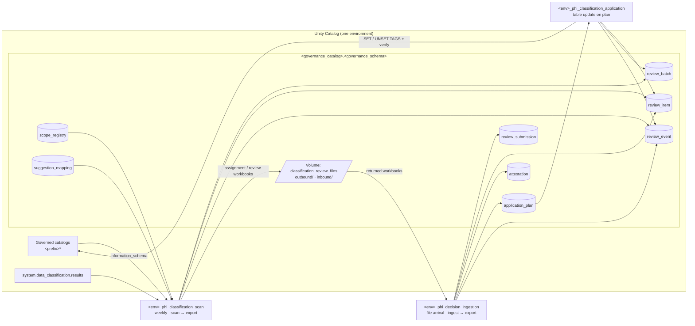

# PHI Classification Framework for Unity Catalog

A reference implementation of a repeatable, auditable process for classifying
Protected Health Information (PHI) at the column level in Unity Catalog. It
finds in-scope columns that lack a direct PHI governed tag, routes them to
Data Stewards for ratification, applies the approved tags automatically, and
keeps evidence for every decision.

Two outcomes are valid for every column:

1. **It contains PHI** and receives an approved value of the governed tag
   (default key `phi_classification`).
2. **It is confirmed not to contain PHI** and receives a documented,
   time-bound non-PHI attestation.

> A missing tag never means "not PHI". It means "not yet classified or attested".

Phase 1 (this repository) runs the steward review through Excel workbooks
exchanged via a governed Unity Catalog Volume. Phase 2 replaces the workbooks
with a Databricks App that writes the same submission records, so the jobs and
tables do not change.

This is a reference implementation built and tested against synthetic data.
Review it, adapt it, and validate it in your own environment before relying on
it for compliance evidence.

---

## Contents

- [Architecture](#architecture)
- [Prerequisites](#prerequisites)
- [Configuration](#configuration)
- [Deploy](#deploy)
- [Operate: the weekly cycle](#operate-the-weekly-cycle)
- [Governance records](#governance-records)
- [Security and access](#security-and-access)
- [Testing](#testing)
- [Repository layout](#repository-layout)
- [Phase 2: Databricks App](#phase-2-databricks-app)
- [Further reading](#further-reading)

---

## Architecture

Each environment (dev, qa, prod) runs its own deployment that processes only
that environment's catalogs.



### The eight-step operating flow

| # | Step | Who | What happens |
|---|---|---|---|
| 1 | Define scope | Data Governance | Maintain `classification_scope_registry` (catalog/schema, risk tier, steward group) and `classification_suggestion_mapping`. |
| 2 | Weekly scan | `scan` job (Monday 06:00) | Reads metadata, tags, attestations, and Data Classification results. Opens or refreshes one review item per actionable column and exports an ASSIGNMENT workbook for unassigned items. |
| 3 | Assign and review | Data Governance, Data Stewards | Data Governance fills in `assigned_steward` and uploads the workbook. Ingestion exports one REVIEW workbook per steward. Data Governance emails it, and the steward records decisions. |
| 4 | Receive responses | Data Governance | Uploads each returned workbook to `inbound/` as a new file (never overwriting). |
| 5 | Ingest and validate | `ingestion` job (file arrival) | Validates decisions and writes immutable plans, non-PHI attestations, Privacy routing, or `VALIDATION_FAILED`. Exports follow-up workbooks. |
| 6 | Apply tags | `application` job (table-update trigger) | Rechecks each column, executes the stored DDL, verifies the tag in `information_schema.column_tags`. |
| 7 | Record results | all jobs | Item statuses, batch closure, and an append-only event trail. |
| 8 | Repeat | `scan` job | Unchanged valid decisions are skipped; changed, stale, and recertification-due columns reopen. |

### What the scan detects

One issue type per column per scan, using the first match in this order:

| Issue type | Meaning |
|---|---|
| `CORRECTION_REQUESTED` | Data Governance reopened a resolved column (on-demand scan run). |
| `INVALID_TAG_VALUE` | The tag value is not in the governed tag's allowed values. |
| `STALE_PHI_REVIEW` | A verified PHI column's name, type, or comment changed. |
| `STALE_NON_PHI_ATTESTATION` | An attested column's name, type, or comment changed. |
| `ORPHANED_TAG` | A tag without framework review evidence (off by default). |
| `RECERTIFICATION_DUE` | Three months (HIGH) or six months (STANDARD) since verification or attestation. |
| `MISSING_CLASSIFICATION` | No tag and no non-PHI attestation. |

Suggestions come from Data Classification: high-confidence detections only,
the latest detection only, and only when every detection maps to the same
allowed value. Sample values are never read into the framework.

---

## Prerequisites

| Requirement | Notes |
|---|---|
| Databricks CLI ≥ 0.288 | `databricks -v` |
| [uv](https://docs.astral.sh/uv/) | Builds the wheel and runs the operator tools. |
| Python 3.12 | For local tests and tools (uv installs it if needed). |
| Unity Catalog workspace per environment | Serverless jobs enabled. |
| Governed tag | An account-level tag policy (default key `phi_classification`) with the allowed values. Its values are the single source of truth for validation. |
| Data Classification | Enabled on each governed catalog, with `SELECT` on `system.data_classification.results` granted to the framework identity only. |
| SQL warehouse | Used by `scripts/deploy.sh` to bootstrap the schema and by the operator tools. |
| Groups | One Data Governance group, one Data Platform group, and one steward group per scope. |
| Service principal | qa and prod jobs run as a dedicated service principal. |

---

## Configuration

All configuration is bundle variables (`databricks.yml`), overridable per target
or with `BUNDLE_VAR_<name>` environment variables.

| Variable | Default | Purpose |
|---|---|---|
| `env` | per target | `dev`, `qa`, or `prod`. Logical job names are `<env>_phi_classification_scan`, `<env>_phi_decision_ingestion`, `<env>_phi_classification_application`. |
| `governance_catalog` | per target | Catalog that holds the governance schema. |
| `governance_schema` | `data_governance` | Governance schema. |
| `governed_catalog_prefix` | per target | Every governed catalog in the environment starts with this prefix. Enforced by a CHECK constraint and by every job. |
| `tag_key` | `phi_classification` | Governed tag applied to PHI columns. |
| `governance_group` | per target | May record Privacy outcomes and request corrections. Gets `CAN_MANAGE_RUN` on the scan and ingestion jobs. |
| `platform_group` | per target | Gets `CAN_MANAGE` on all jobs. |
| `framework_service_principal` | `""` | Application ID the qa and prod jobs run as (required there). |
| `data_classification_table` | `system.data_classification.results` | Set to `""` to disable suggestions. |
| `review_due_business_days` | `10` | Steward SLA used for `due_at`. |
| `business_timezone` | `UTC` | Scan schedule and the 17:00 due time. |
| `detect_orphaned_tags` | `false` | Enable `ORPHANED_TAG` findings. |
| `workbook_protection_password` | `phi-review` | Excel sheet protection. Prevents accidental edits only; it is **not** a security control. |
| `allowed_values_override` | `""` | **dev only**: comma-separated allowed values for sandboxes without a governed tag policy. Rejected in qa and prod. |
| `failure_notification_emails` | `[]` | Notified when any job fails. |

Edit the qa/prod target blocks in `databricks.yml` with your catalog names and
groups, or supply them from CI as `BUNDLE_VAR_*` variables.

---

## Deploy

```bash
# 1. Validate and deploy (bootstrap DDL first, then the bundle)
scripts/deploy.sh dev  <warehouse_id> <cli_profile>
scripts/deploy.sh qa   <warehouse_id>            # CI: DATABRICKS_HOST + OAuth M2M
scripts/deploy.sh prod <warehouse_id>            # prod deploys only from CI

# 2. Load Data Governance reference data (scope registry and mapping)
uv run python tools/load_reference_data.py -p <profile> --warehouse-id <id> \
    --catalog <governance_catalog> --schema data_governance \
    --scopes reference_data/scope_registry.csv \
    --mapping reference_data/suggestion_mapping.csv

# 3. Run the first scan (dev: jobs run only when started manually)
databricks bundle run phi_classification_scan -t dev -p <profile>
```

Why `scripts/deploy.sh` and not just `bundle deploy`: Lakeflow Jobs validates
trigger targets when a job is created, so the Volume (file-arrival trigger) and
the plan table (table-update trigger) must exist first. The script runs
`tools/bootstrap.py`, which executes the same setup code as the
`<env>_phi_framework_setup` job through a SQL warehouse, then deploys the
bundle. Both steps are idempotent. Rerun the setup job after upgrades to apply
new columns, comments, or constraint changes.

**Promotion.** Validate in dev, deploy to qa from CI, then promote the same
commit to prod. qa and prod run as `framework_service_principal`; the bundle
refuses to validate without it.

**Development mode** prefixes job names with `[dev <user>]` and pauses the
schedule and both triggers. The jobs still write the logical `process_name`
(for example `dev_phi_classification_scan`), so the audit CHECK constraints
hold.

---

## Operate: the weekly cycle

**Monday: scan.** The scan opens items and writes an ASSIGNMENT workbook per
batch to `outbound/<review_batch_id>/`.

**Data Governance: assign.** Download the ASSIGNMENT workbook, fill in
`assigned_steward` (a member of the scope's `steward_group`), and upload it to
`inbound/`. Ingestion runs on file arrival and writes one REVIEW workbook per
steward to `outbound/`.

**Data Governance: send.** Email each REVIEW workbook using the templates in
the process document. `reviewed_by` is pre-filled with the assigned steward.

**Steward: decide.** For each row, set `decision`
(`APPROVE_SUGGESTION`, `CORRECT_CLASSIFICATION` + `corrected_tag_value`,
`CONFIRM_NOT_PHI` + comment, or `REQUEST_PRIVACY_REVIEW` + comment) and
`reviewed_at` as `YYYY-MM-DD HH:MM ±HH:MM` (for example `2026-10-14 11:40 -04:00`).

**Data Governance: upload.** Upload each returned workbook to `inbound/` as a
new file, for example `<review_batch_id>_<steward>_v1.xlsx`, then `_v2` for a
revision. Never overwrite. Files are identified by SHA-256, so re-uploading
identical content is ignored and renaming a file does not reprocess it.

**Automatic: ingest and apply.** Valid decisions become plans and attestations.
Tags are applied and verified within minutes. Rejected rows go back out in a
new REVIEW workbook with `last_validation_error` filled in.

**Privacy review.** Items in `NEEDS_PRIVACY_REVIEW` appear in a PRIVACY workbook.
Once Privacy decides, a Data Governance user records the outcome there
(`reviewed_by` must be in `governance_group`) and uploads it.

**Corrections.** To change an accepted decision, run the scan on demand:

```bash
databricks bundle run phi_classification_scan -t prod --params \
  correction_column=<catalog>.<schema>.<table>.<column>,\
correction_reason="<why>",correction_requested_by=<you@example.com>
```

This opens a `CORRECTION_REQUESTED` item in a new batch, pre-filled with the
current tag. If the column already has an open item, nothing is opened and that
item's decision serves as the correction.

**Application failures.** Failed items keep `application_error`, and the job
run fails so `failure_notification_emails` are alerted. After remediation, run
the application job with `retry_failed=true`. If the column changed after
approval, the next scan closes the failed item and reopens the column for review.

**Monthly review.** Example queries are in `docs/queries.sql`: classification
completeness, aging and overdue items, failures by reason, and changes ignored
for already-accepted items.

---

## Governance records

All in `<governance_catalog>.<governance_schema>`:

| Table | Rows change | Written by |
|---|---|---|
| `classification_scope_registry` | Created and updated | Data Governance (`MANUAL`) |
| `classification_suggestion_mapping` | Created and updated | Data Governance (`MANUAL`) |
| `classification_review_batch` | Created and updated | Jobs |
| `classification_review_item` | Created and updated | Jobs |
| `classification_attestation` | Created; superseded | Jobs |
| `classification_application_plan` | Append-only | Ingestion |
| `classification_review_event` | Append-only | Jobs |
| `classification_review_submission` | Append-only | Ingestion (Phase 2: the App) |

Integrity controls (all created by `src/phi_framework/setup.py`):

- **Deterministic keys** (`make_key`): reruns and retries never duplicate rows.
- **CHECK constraints** on every controlled value, the environment/catalog
  guardrail, and audit process names (`MANUAL` only on the two reference tables).
- **`delta.appendOnly`** on plans, events, and submissions.
- **Informational PK/FK constraints**, **NOT NULL**, and column comments.
- **Deletion vectors and row tracking** for row-level concurrency.
  `max_concurrent_runs: 1` per job, and task retries.
- **Audit columns** on every row (`audit_created_*`, `audit_updated_*`).

---

## Security and access

Minimum grants (verify in your environment; names are illustrative):

| Principal | Grants |
|---|---|
| Framework service principal | `USE CATALOG`, `USE SCHEMA`, and `SELECT` (or `BROWSE`) on governed catalogs so their objects appear in `information_schema`; `APPLY TAG` on governed catalogs; `ASSIGN` on the governed tag policy; `SELECT` on `system.data_classification.results`; `ALL PRIVILEGES` on the governance schema; `READ VOLUME` / `WRITE VOLUME` on the review Volume. |
| Data Governance group | `SELECT` on governance tables; `MODIFY` on `classification_scope_registry` and `classification_suggestion_mapping`; `READ VOLUME` / `WRITE VOLUME`; `CAN_MANAGE_RUN` on the scan and ingestion jobs. |
| Data Stewards | No direct access in Phase 1; they receive workbooks from Data Governance. |

Notes:

- Data Classification `samples` are never selected, so sample values never reach
  governance tables, workbooks, or email.
- Workbooks contain column metadata (names, types, comments), not table data.
  Column comments are free text, so keep them free of PHI.
- Phase 1 limitation (accepted for the pilot): `reviewed_by` and `reviewed_at` are
  self-reported. Mitigations: Data Governance uploads only workbooks returned by the
  assigned steward, ingestion validates group membership and time, and every file is
  recorded by path and SHA-256 in `WORKBOOK_INGESTED`. Phase 2 captures authenticated
  identity.

---

## Testing

```bash
# Unit tests (no workspace needed)
uv run --with pytest pytest

# Lint
uv run ruff check src tests tools

# End-to-end against a dev sandbox with synthetic data
uv run --with openpyxl python tests/integration/e2e_sandbox.py \
    -p <profile> --warehouse-id <id> --reset \
    --mapping <mapping CSV whose values match the tag policy> \
    --steward-group <dev test steward group>
```

Before running it:

- **Use a throwaway governance schema.** Set the bundle's `governance_schema` to a test
  schema such as `phifw_e2e`. `--reset` drops and recreates the governance schema and the
  synthetic schemas, and it refuses to run unless every one of them starts with `phifw_`.
  A real `data_governance` schema can never be dropped by the test.
- **Join both test groups.** Create a dev-only steward group and pass it as `--steward-group`.
  The user running the test must belong to that group and to the bundle's `governance_group`.

`--mapping` must point to a mapping whose values exist in your tag policy.
`tests/integration/fixtures/suggestion_mapping_hipaa18.csv` targets an 18-identifier
HIPAA value list (`name`, `address`, `date`, `phone_number`, `ssn`, `mrn`, `account_number`, ...).
With a governed tag, the test exercises `ORPHANED_TAG` instead of `INVALID_TAG_VALUE`,
because Unity Catalog rejects values outside the policy.

The end-to-end test seeds synthetic tables, a materialized view, and synthetic
Data Classification results. It then drives the real jobs through assignment,
every decision type, validation failures, Privacy outcomes, ignored changes,
duplicate uploads, stale detection, removed columns, a correction with tag
removal, and append-only/CHECK enforcement. `--reset` drops the governance and
synthetic schemas and refuses to run unless `env` is `dev`.

---

## Repository layout

```
databricks.yml                 Bundle: variables and dev/qa/prod targets
resources/
  setup.job.yml                <env>_phi_framework_setup (idempotent DDL)
  scan.job.yml                 <env>_phi_classification_scan (weekly + corrections) -> export
  ingestion.job.yml            <env>_phi_decision_ingestion (file arrival) -> export
  application.job.yml          <env>_phi_classification_application (table update)
src/phi_framework/
  constants.py                 Controlled vocabularies (rendered into CHECK constraints)
  config.py                    Job parameters -> Settings
  ddl.py / setup.py            Table definitions and idempotent reconciliation
  keys.py                      Deterministic keys and column fingerprint
  runtime.py                   Spark/SDK context, audit columns, event writer
  directory.py                 Tag policy values and group membership
  scan.py                      Issue detection, suggestions, item/batch lifecycle
  export.py / workbook.py      Excel layouts, export, parsing
  validation.py                Pure decision-validation rules
  ingest.py                    Submissions -> plans, attestations, events
  tag_ddl.py / apply.py        Tag DDL rendering, application, verification
  batches.py                   Due dates and batch closure
tools/
  bootstrap.py                 Run setup through a SQL warehouse before deploy
  load_reference_data.py       Data Governance: upsert scope registry and mapping
  sqlexec.py                   SQL warehouse helper
scripts/deploy.sh              validate -> bootstrap -> deploy
reference_data/                Example scope registry, mapping, allowed values
tests/unit/                    pytest unit tests
tests/integration/             End-to-end sandbox test
docs/                          Design notes, spike results, user stories, queries
```

---

## Phase 2: Databricks App

The App replaces the workbooks without changing jobs or tables:

- Stewards see their queue and submit decisions. The App writes rows to
  `classification_review_submission` with `source_type = 'APP'`, the authenticated
  user as `reviewed_by`, and the submission time.
- Ingestion's `process_submission_set` validates them exactly as it validates
  workbook rows.
- Add `APP` handling for discovering unprocessed submission sets, and add the App's
  identity to the process-name constraint on the submission table only.

---

## Further reading

- `docs/design-notes.md`: deviations from the process design and open items
- `docs/spike-results.md`: platform spikes and what they found
- `docs/user-stories.md`: the consolidated pilot backlog
- `docs/queries.sql`: monitoring and metrics queries
